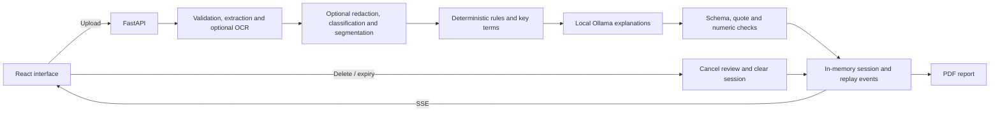

# ClauseLoom

ClauseLoom helps people understand rental and freelance contracts before signing.
It combines deterministic risk rules with explanations from a locally hosted
small language model, presented through a React interface.

**Informational only, not legal advice. A low score does not establish that a
contract is safe. Consult a qualified lawyer for important decisions.**

## Features

- Upload PDF, DOCX, UTF-8 TXT, PNG or JPEG files; scanned documents use local OCR.
- Screen rental and freelance clauses using configurable rules and thresholds.
- Read English or Hindi explanations with evidence quotes checked against the source.
- See streamed results, risk filters, clause search, key terms and negotiation questions.
- Export a PDF report, redact common identifiers and delete an active review.
- Use light/dark mode, keyboard navigation and the responsive mobile interface.

There is no database or account system. Review state lives in server memory and
expires automatically. Document processing and model inference run on your own
hosting infrastructure; the app does not call an external AI inference API.

## Technology

| Layer | Implementation |
| --- | --- |
| Interface | React 19, TypeScript, Vite, Tailwind CSS, Lucide icons, self-hosted Inter |
| API | FastAPI, Uvicorn, Pydantic, Server-Sent Events (SSE) |
| Document processing | PDFium via pypdfium2, python-docx, Pillow, Tesseract OCR |
| Contract screening | Python rule engine with jurisdiction-specific YAML settings |
| Local inference | Ollama; JSON schema, quote and numeric validation |
| Reports | ReportLab, Noto fonts and HarfBuzz for Hindi shaping |
| Deployment | Docker Compose or a single-container CPU image |
| Checks | pytest, Ruff, Vitest, TypeScript and GitHub Actions |

Python 3.11 is used in Docker; local Python 3.12 is also tested. Use Node.js 22
for frontend development. Package versions are pinned in the requirements files
and frontend lockfile.

## Get the source

This repository is private. With access to the GitHub repository:

```sh
git clone https://github.com/itz-naman007/clauseloom.git
cd clauseloom
```

## Quick start with Docker

Install Docker Engine/Desktop with a running Linux engine and Docker Compose
2.24 or newer. Allow several GB of RAM for inference and OCR; first setup needs
internet access to download images, dependencies and model weights.

```sh
cp .env.example .env
docker compose up --build -d
docker compose logs -f ollama-init app
```

PowerShell uses `Copy-Item .env.example .env` for the first command.

Open **http://localhost:8080**. The default Compose model is
`qwen2.5:3b-instruct`. Initial model download and warmup can take several minutes.

```sh
curl -f http://localhost:8080/api/health
curl -f http://localhost:8080/api/ready
```

`/api/health` checks the API. `/api/ready` returns 200 after the model is available
and an inference request has succeeded; it returns 503 while degraded. Rule-only
screening remains available when AI explanations cannot be produced.

```sh
docker compose down
```

Stopping Compose preserves its model volume. Ollama's port 11434 is internal to
the Compose network and should never be published to the internet.

## Local development

Install Python 3.11 or 3.12, Node.js 22, and Ollama. Start the local Ollama service
and download the configured model before starting the application.

### macOS / Linux

```sh
python -m venv .venv
. .venv/bin/activate
python -m pip install -r backend/requirements-dev.txt
npm --prefix frontend ci
ollama pull qwen2.5:3b-instruct
export LLM_BASE_URL=http://127.0.0.1:11434
export LLM_MODEL=qwen2.5:3b-instruct
python scripts/dev.py
```

### Windows PowerShell

```powershell
py -3.12 -m venv .venv
.\.venv\Scripts\Activate.ps1
python -m pip install -r backend/requirements-dev.txt
npm.cmd --prefix frontend ci
ollama pull qwen2.5:3b-instruct
$env:LLM_BASE_URL='http://127.0.0.1:11434'
$env:LLM_MODEL='qwen2.5:3b-instruct'
python scripts/dev.py
```

The frontend runs at **http://localhost:5173** and proxies `/api` to FastAPI at
**http://127.0.0.1:8080**. The development helper does not enable backend reload;
restart it after Python edits. Local development does not automatically load `.env`.

For image or scanned-PDF input, install Tesseract with `eng` and `hin` language
data and put it on PATH. Text-based PDF, DOCX and TXT files work without OCR.
Docker installs the OCR packages and report fonts automatically.

### Production frontend build

```sh
npm --prefix frontend run build
python -m uvicorn app.main:app --app-dir backend --host 127.0.0.1 --port 8080 --workers 1 --no-access-log
```

Vite writes the production assets to `backend/app/static/`. FastAPI serves those
assets and the API from the same origin. The generated assets are excluded from
Git and rebuilt during Docker image creation.

## Architecture



Rules determine which flags exist and their final severity. The model explains
clauses; it cannot introduce flags or override rule severity. Invalid model
outputs receive one repair attempt, then fall back to clearly labeled rule-only
results. A matching quote does not prove the interpretation is correct.

The review score is `min(100, high × 15 + medium × 7 + low × 2)`. Score bands are
0–25, 26–55 and 56–100. Every detected flag counts, including related findings in
one clause. A missing-protection finding means a protection was not detected in
the supplied text, not that it is definitively absent.

See [architecture and API reference](docs/architecture.md) for component
responsibilities, request flow, configuration defaults and session lifecycle.

## Repository structure

```text
.
├── backend/
│   ├── app/
│   │   ├── main.py              # Routes, middleware, streaming and lifecycle
│   │   ├── config.py            # Environment settings and endpoint restrictions
│   │   ├── models.py            # Typed clauses, flags and explanation schema
│   │   ├── core/                # Extraction, OCR, redaction, pipeline and sessions
│   │   ├── llm/                 # Local-model adapter, prompts and output guards
│   │   ├── rules/               # Rule engine and jurisdiction YAML settings
│   │   └── report/              # English/Hindi PDF generation
│   ├── tests/                   # API, rules, parser, inference and deployment tests
│   ├── requirements.txt         # Runtime dependencies
│   └── requirements-dev.txt     # Runtime plus test/lint tools
├── frontend/
│   ├── src/pages/App.tsx        # Upload interface and review state
│   ├── src/components/          # Result dashboard
│   ├── src/lib/                 # Payload types, filtering and tests
│   ├── src/i18n/                # English/Hindi interface strings
│   └── package-lock.json        # Reproducible frontend dependencies
├── deploy/                     # Reverse proxy, resource profiles and hosting files
├── docs/                       # Architecture, deployment, verification and demo
├── eval/                       # Synthetic rule corpus and model evaluation
├── samples/                    # Fictional rental/freelance documents
├── scripts/                    # Development, packaging and live verification tools
├── .github/workflows/ci.yml     # Automated backend and frontend checks
├── .env.example                # Non-secret configuration template
├── Dockerfile                  # App image with compiled React assets
├── docker-compose.yml          # App, Ollama and one-time model initialization
└── THIRD_PARTY_NOTICES.md       # Dependency and model license references
```

`artifacts/`, virtual environments, model weights, caches, `node_modules/` and
compiled frontend assets are local/generated data and are not committed.
The historical project brief is retained under `docs/reference/`.

## Configuration

Copy `.env.example` for Docker Compose. For local development, export settings
in your shell. Restart the server after changing them.

| Setting | Purpose |
| --- | --- |
| `LLM_BASE_URL` | Local/private inference URL; Compose fixes it to `http://ollama:11434` |
| `LLM_MODEL` | Exact installed model tag; Compose defaults to `qwen2.5:3b-instruct` |
| `LLM_CONCURRENCY` | Limit simultaneous inference requests; use 1 on small CPU hosts |
| `LLM_NUM_CTX` | Model context size; 2048 reduces the default 4096-token allocation |
| `LLM_NUM_THREADS` | CPU inference threads; 0 uses the server default |
| `LLM_TIMEOUT` | Timeout for an individual inference HTTP request |
| `ALLOWED_ORIGINS` | Comma-separated allowed browser origins |
| `FRAME_ANCESTORS` | Allowed embedding origins; defaults to blocking all framing |
| `MAX_UPLOAD_MB`, `MAX_PAGES` | Upload and PDF page limits; defaults are 10 MB / 30 pages |
| `SESSION_TTL_MIN` | Session lifetime; default 30 minutes from creation |
| `MAX_SESSIONS`, `MAX_MEMORY_MB` | Admission limits for in-memory reviews |
| `RATE_LIMIT` | Analyses per hour per direct peer IP; default `10/hour` |
| `DEFAULT_JURISDICTION` | `india` or `default` rule thresholds |

The app also limits extracted text to 150,000 characters, image dimensions to
24 megapixels and reviews to 60 clauses. `LLM_ENABLED=false` is a deliberate
rule-only testing switch, not the normal inference configuration.

## Tests and evaluation

Run from the repository root with development dependencies installed:

```sh
python -m pytest -q
python -m ruff check backend eval scripts
npm --prefix frontend test
npm --prefix frontend run build
```

`make test`, `make lint` and `make build` provide shortcuts. GitHub Actions runs
backend lint/tests and frontend tests/build on pushes and pull requests. It does
not publish or deploy the application.

To verify a running server using only fictional documents:

```sh
python scripts/verify_live.py --base http://localhost:8080 --kind rental --require-ai
python scripts/verify_live.py --base http://localhost:8080 --kind freelance --lang hi --require-ai
python scripts/verify_formats.py --base http://localhost:8080
```

The live scripts check streaming, findings, PDF export, deletion and supported
formats. Reports are saved under ignored `artifacts/`. `sh scripts/smoke.sh` builds
and checks the Compose deployment.

```sh
python eval/run_eval.py
python eval/run_eval.py --models qwen2.5:3b qwen2.5:1.5b --limit 6
```

The evaluator writes `eval/RESULTS.md`; preserve earlier measurements before
rerunning it. The 62-clause synthetic development corpus is a regression set,
not independent legal validation. See [evaluation results](eval/RESULTS.md) and
[verification record](docs/verification.md) for measured results and limitations.

## Deployment

The standard deployment uses Docker Compose with a private Ollama service.
An alternative CPU image bundles the React assets, API, OCR and a predownloaded
1.5B model in one container. Both serve the same interface.

See the [deployment guide](docs/deployment.md) for VPS setup, HTTPS, resource
profiles, single-container hosting, health checks and troubleshooting. Review
[deployment readiness](docs/deployment-readiness.md) before accepting public
traffic or confidential contracts. No hosted deployment is claimed by this repo.

## Privacy and operational limits

- Processing happens on the app host. On a cloud VM, it is not processing on the
  visitor's own device. Installation and model downloads require network access.
- Review text, results, replay events and caches live in RAM. Multipart parsing
  and OCR may use private temporary files. Compose uses a read-only app filesystem
  and temporary storage; deletion is not a guarantee of secure memory erasure.
- Session URLs contain bearer tokens. Anyone holding a token can access the
  review until deletion or expiry. Downloads and clipboard copies remain outside
  server deletion control.
- Use one worker and one replica. Sessions disappear on restart and are not
  shared across processes or machines.
- The peer-IP rate limiter can group visitors behind a reverse proxy into one
  bucket. Add correctly configured edge controls for a public service.
- Native parser/OCR limits are not a hostile-file sandbox. Outstanding container
  OS advisories and the other launch risks are documented in the readiness review.
- Rules primarily detect English source wording. Hindi explanations do not make
  the rule engine a multilingual legal parser. Redaction and model grounding are
  best-effort, and unflagged text is not guaranteed safe.

## Documentation and contribution

- [Architecture, API and configuration reference](docs/architecture.md)
- [Deployment and troubleshooting](docs/deployment.md)
- [Measured verification](docs/verification.md)
- [Deployment readiness and unresolved risks](docs/deployment-readiness.md)
- [Demo walkthrough](docs/demo.md)
- [Third-party notices](THIRD_PARTY_NOTICES.md)

Keep this repository private as intended. Review `git diff --cached` before
committing; never commit credentials, real contracts, reports or model weights.
Use feature branches for changes and run the checks above before opening a pull
request. Repository CI checks the application; deployment remains a separate step.

No project-wide open-source license is granted by the presence of this repository.
Preserve dependency/model licenses when distributing builds; see the notices file.
