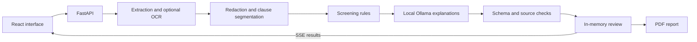

# ClauseLoom

**Unravel the fine print.**

ClauseLoom helps tenants and freelancers read a contract before signing. Upload
a document, review flagged clauses alongside the source text, and leave with
questions to ask the other party. The app combines configurable screening rules
with English or Hindi explanations from a self-hosted language model.

ClauseLoom provides information, not legal advice. Its score reflects matched
rules; a low score does not mean a contract is safe.

## What it does

- Reads PDF, DOCX, TXT, PNG and JPEG files, with OCR for scanned documents.
- Screens rental and freelance agreements for supported risk patterns.
- Streams clause results, key terms and suggested negotiation questions.
- Checks model explanations against source quotes and numeric values.
- Exports a PDF report and lets the user delete an active review.
- Supports English/Hindi explanations, light/dark themes and mobile layouts.

Processing runs on the app's host, including inference through Ollama. There is
no external AI inference API or database. On a cloud deployment, documents are
processed on that server, not on the visitor's device.

## Run with Docker

You need Docker with a running Linux engine and Compose 2.24 or newer. Allow
several GB of RAM for the model and OCR. The first build downloads dependencies
and model weights.

```sh
git clone https://github.com/itz-naman007/clauseloom.git
cd clauseloom
cp .env.example .env
docker compose up --build -d
docker compose logs -f ollama-init app
```

The repository is private, so cloning requires access. In PowerShell, use
`Copy-Item .env.example .env` in place of `cp`.

Open **http://localhost:8080**. Compose downloads `qwen2.5:3b-instruct` before
starting the app; download and warmup may take several minutes.

```sh
curl -f http://localhost:8080/api/health
curl -f http://localhost:8080/api/ready
```

Health checks API liveness. Readiness returns 200 once the model is available and
inference has succeeded. If an explanation fails, the app can still show results
from the rules, labeled accordingly.

Use `docker compose down` to stop the stack. Model weights remain in the Docker
volume. Ollama's port is internal to the Compose network.

## Develop locally

Install Python 3.11 or 3.12, Node.js 22 and Ollama. Start Ollama before launching
the app. Docker uses Python 3.11; local checks also cover Python 3.12.

### macOS / Linux

```sh
python -m venv .venv
. .venv/bin/activate
python -m pip install -r backend/requirements-dev.txt
npm --prefix frontend ci
ollama pull qwen2.5:3b-instruct
export LLM_BASE_URL=http://127.0.0.1:11434
export LLM_MODEL=qwen2.5:3b-instruct
python scripts/dev.py
```

### Windows PowerShell

```powershell
py -3.12 -m venv .venv
.\.venv\Scripts\Activate.ps1
python -m pip install -r backend/requirements-dev.txt
npm.cmd --prefix frontend ci
ollama pull qwen2.5:3b-instruct
$env:LLM_BASE_URL='http://127.0.0.1:11434'
$env:LLM_MODEL='qwen2.5:3b-instruct'
python scripts/dev.py
```

Open **http://localhost:5173**. Vite proxies `/api` to FastAPI on port 8080.
Restart the helper after Python changes; it does not enable backend reload.
Local Python reads environment variables from your shell, not from `.env`.

For OCR, install Tesseract with `eng` and `hin` language data and add it to PATH.
Text-based PDFs, DOCX and TXT files do not need OCR. Docker includes Tesseract
and the fonts used for PDF reports.

To serve the compiled frontend directly from FastAPI:

```sh
npm --prefix frontend run build
python -m uvicorn app.main:app --app-dir backend --host 127.0.0.1 --port 8080 --workers 1 --no-access-log
```

## How it works



Rules determine the flags and their severity. The model explains those findings;
it cannot add flags or change their severity. Invalid responses get one repair
attempt before the app falls back to a rule-only explanation. Source checks help
catch unsupported output, but do not establish that an interpretation is correct.

The frontend uses React 19, TypeScript, Vite and Tailwind. The backend uses
FastAPI, PDFium, python-docx, Pillow and Tesseract; ReportLab and HarfBuzz handle
PDF reports. See the [architecture reference](docs/architecture.md) for the API,
score formula, session lifecycle and full configuration table.

## Project layout

```text
backend/app/       API, document pipeline, rules, model adapter and reports
backend/tests/     Backend and deployment tests
frontend/src/      React UI, translations and frontend tests
deploy/            Hosting files, reverse proxy and resource profiles
docs/              Architecture, deployment and verification guides
eval/              Synthetic regression corpus and model evaluation
samples/           Fictional rental and freelance documents
scripts/           Development, packaging and live verification tools
```

The root `Dockerfile` builds the app; `docker-compose.yml` adds Ollama and model
initialization. Frontend builds go to `backend/app/static/`. Build output, virtual
environments, model weights and QA artifacts are excluded from Git.

## Configuration

For Compose, copy `.env.example` and edit it before starting the stack. For local
development, export settings in your shell. Restart the app after changes.

| Setting | When to change it |
| --- | --- |
| `LLM_MODEL` | Use another installed model; the Compose default is `qwen2.5:3b-instruct` |
| `LLM_CONCURRENCY`, `LLM_NUM_CTX`, `LLM_NUM_THREADS` | Tune inference for the host's memory and CPU allocation |
| `LLM_TIMEOUT` | Allow longer individual inference requests on slower hosts |
| `ALLOWED_ORIGINS` | Set the exact browser origin for a hosted deployment |
| `MAX_UPLOAD_MB`, `MAX_PAGES` | Adjust the default 10 MB / 30-page input limits |
| `MAX_SESSIONS`, `MAX_MEMORY_MB` | Set admission limits for in-memory reviews |
| `DEFAULT_JURISDICTION` | Select `india` or `default` rule thresholds |

The [deployment guide](docs/deployment.md) includes a smaller CPU profile and a
single-container image with a bundled 1.5B model.

## Checks and evaluation

With development dependencies installed, run from the repository root:

```sh
python -m pytest -q
python -m ruff check backend eval scripts
npm --prefix frontend test
npm --prefix frontend run build
```

GitHub Actions runs backend lint/tests and frontend tests/build on pushes and
pull requests. It does not deploy the app.

To check a running instance with fictional documents:

```sh
python scripts/verify_live.py --base http://localhost:8080 --kind rental --require-ai
python scripts/verify_live.py --base http://localhost:8080 --kind freelance --lang hi --require-ai
python scripts/verify_formats.py --base http://localhost:8080
```

For rule evaluation, run `python eval/run_eval.py`. To include local models, use
`python eval/run_eval.py --models qwen2.5:3b qwen2.5:1.5b --limit 6`. Each run
replaces `eval/RESULTS.md`, so save any measurements you want to keep first.
The 62-clause corpus is a development regression set, not independent legal
validation. [Recorded results](eval/RESULTS.md) include the model's limitations.

## Before hosting

Use one worker and one replica: sessions live in memory, expire after 30 minutes
by default, and disappear on restart. Session URLs contain bearer tokens;
anyone with a token can access that review until deletion or expiry.

Multipart parsing and OCR can use temporary files. Deletion clears session state
but does not securely erase memory or remove downloaded reports. Identifier
redaction is best-effort. Rules primarily match English source text, even when
explanations are requested in Hindi.

Local container checks have passed; a public deployment still needs hosted
acceptance tests, access controls and assessment of outstanding container
advisories. Follow the [deployment guide](docs/deployment.md) and
[launch review](docs/deployment-readiness.md) before accepting public traffic.

## Further reading

- [Architecture, API and configuration](docs/architecture.md)
- [Deployment and troubleshooting](docs/deployment.md)
- [Verification record](docs/verification.md)
- [Launch review and remaining work](docs/deployment-readiness.md)
- [Demo walkthrough](docs/demo.md)
- [Product brief](docs/reference/design-brief.md)
- [Third-party notices](THIRD_PARTY_NOTICES.md)

Keep credentials, real contracts, generated reports and model weights out of
commits. Use feature branches and run the relevant checks before opening a PR.
This private repository does not grant an open-source license for ClauseLoom;
third-party components retain their own licenses.
