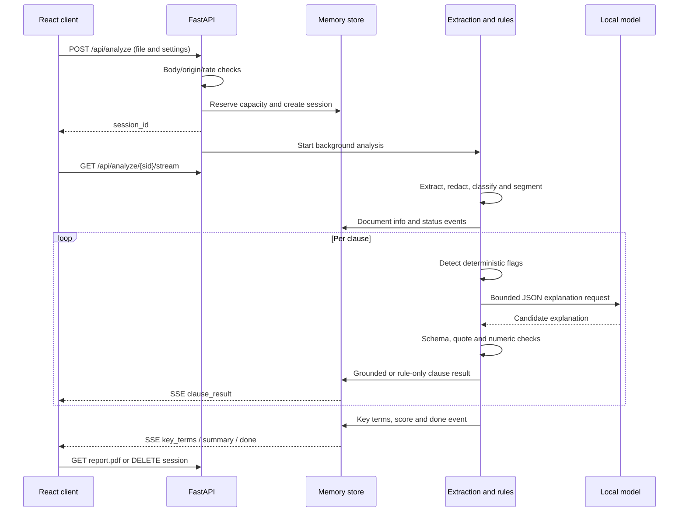

# Architecture and API reference

ClauseLoom has three main parts: a React browser client, one FastAPI process
and a self-hosted inference service. Reviews live in memory; there is no database
or durable job queue. Run commands from the repository root.

## Components

| Component | Responsibility | Main files |
| --- | --- | --- |
| Browser client | Upload/sample selection, language, theme, streamed dashboard, filters and deletion | `frontend/src/pages/App.tsx`, `frontend/src/components/Results.tsx` |
| API boundary | Input limits, origins, security headers, routes, SSE and lifespan tasks | `backend/app/main.py`, `backend/app/core/body_limit.py` |
| Extraction | Validate content signatures; extract PDF/DOCX/TXT or perform OCR | `backend/app/core/extract.py`, `backend/app/core/ocr.py` |
| Preparation | Optional identifier redaction, contract classification and source offsets | `backend/app/core/redact.py`, `doctype.py`, `segment.py` |
| Rule engine | Clause findings, missing-protection checks and initial key terms | `backend/app/rules/engine.py`, `india.yaml`, `default.yaml` |
| Pipeline | Coordinate extraction, rules, concurrent clause tasks, explanations and scoring | `backend/app/core/pipeline.py` |
| Model adapter | Ollama/OpenAI-compatible local HTTP calls, concurrency and warmup | `backend/app/llm/client.py` |
| Output validation | Typed JSON schema, exact-source quote and numeric grounding | `backend/app/models.py`, `backend/app/llm/guard.py` |
| Session store | Bearer tokens, memory reservations, result/cache/event state and expiry | `backend/app/core/session.py` |
| PDF export | In-memory reports with Latin and Devanagari fonts | `backend/app/report/pdf.py` |

A production frontend build writes compiled browser assets to
`backend/app/static/`, which FastAPI mounts after the API routes. In development,
Vite serves the UI and proxies `/api` to the backend.

## Request lifecycle



1. The body-limit middleware buffers at most the configured upload size plus
   64 KiB of multipart overhead before multipart parsing.
2. The upload route closes the upload handle, reserves session memory and starts
   an asynchronous task. It does not wait for model inference before returning.
3. Native extraction runs in a worker thread. PDFium calls share a lock because
   PDFium does not support concurrent calls across threads. Tesseract has a
   per-call OCR timeout.
4. Optional redaction happens before classification, segmentation and inference.
   Clause offsets refer to the analyzed text, including any redaction changes.
5. Contract classification uses deterministic detection first; the local model
   may classify an otherwise unknown opening excerpt. Unknown types receive no
   specialized rental/freelance rules.
6. Clause tasks run concurrently, but a global semaphore bounds model requests.
   Rule findings are calculated before a model explanation is requested.
7. The pipeline extracts key terms using patterns, then performs bounded,
   keyword-retrieved model lookups for relevant missing terms.
8. Final scoring uses deterministic flags. Event replay data and the final
   result remain in memory until deletion or expiry.

## Rules and model output

Rental screening covers supported patterns such as deposits, lock-in, unequal
notice, renewal, access, repair obligations, late charges and restrictions.
Freelance screening covers supported payment, revisions, liability, ownership,
termination and related patterns. Jurisdiction YAML files configure thresholds;
they are review heuristics rather than declarations that a clause is illegal.

The model receives one clause, its rule findings and an explanation example.
The prompt treats source text as data and neutralizes instruction-like wording.
An explanation must match the Pydantic schema, quote text present in the source and introduce no
new numeric tokens in its prose. Hindi responses must contain Devanagari in the
summary. There is one repair attempt for invalid responses; request failures or
repeated validation failures produce rule-only results.

The model cannot add flags or change displayed severity. A clause without a
matched configured rule is displayed as low risk, which is not a safety finding.
Quote/numeric checks do not validate legal interpretation or semantic accuracy.

Per-session explanation caching uses a hash of clause text, language and document
type. Certain unflagged signature/definition clauses skip inference. The model
does not receive the entire document for an individual explanation.

The score is:

```text
min(100, high_flags × 15 + medium_flags × 7 + low_flags × 2)
```

Bands are 0–25, 26–55 and 56–100. Related flags in the same clause all count.
Document-wide absence findings mean a protection was not detected in the supplied
text. The check can miss protections expressed in unfamiliar wording.

## HTTP API

The browser and API normally share an origin. Session IDs are bearer capabilities;
holding a session ID grants access to that review, without a separate login.

| Method | Route | Behavior |
| --- | --- | --- |
| POST | `/api/analyze` | Multipart upload; returns `session_id` and starts analysis |
| GET | `/api/analyze/{sid}/stream` | SSE stream with replay using `Last-Event-ID` |
| GET | `/api/analyze/{sid}` | 202 while processing, 200 for a completed result, 422 for a failed analysis |
| DELETE | `/api/analyze/{sid}` | Cancel the task and clear session results, events and cache |
| GET | `/api/analyze/{sid}/report.pdf` | PDF download; 409 before the review is complete |
| GET | `/api/sample/{kind}` | Fictional `rental` or `freelance` TXT sample |
| GET | `/api/health` | API liveness and current model/session-limit information |
| GET | `/api/ready` | 200 when the model is available and inference has succeeded; otherwise 503 |

The upload fields are `file`, `doc_type` (`auto`, `rental`, `freelance`), `lang`
(`en`, `hi`) and `redact_pii` (boolean). Invalid/deleted/expired session IDs return
404. Upload limits, rate limits and capacity exhaustion return 413, 429 and 503.
FastAPI's interactive API documentation routes are disabled.

### SSE events

| Event | Payload purpose |
| --- | --- |
| `status` | Processing stage, progress and availability notices |
| `doc_info` | Document type, language, page/clause counts and warnings |
| `clause_result` | Source clause, deterministic flags, explanation and confidence |
| `key_terms` | Final extracted term values |
| `summary` | Score, formula, counts, top findings and review label |
| `done` | Completion with the session ID |
| `error` | A user-facing failure message |

Stored events have increasing IDs. Reconnecting clients can request only events
after `Last-Event-ID`. Waiting notices and keepalive pings keep long CPU inference
connections active. The React client closes its stream after completion or error.

## State and resource limits

Sessions use cryptographically random 32-byte tokens. Expiry is measured from
creation, not last activity. The store purges on access and a background task
checks expiry every 15 seconds. Deletion cancels the pipeline and clears stored
results, event history and explanation cache. An in-flight native parser thread
may finish before releasing its buffers.

Each admitted session reserves a conservative budget for input, extracted text,
results and replay duplication. `MAX_MEMORY_MB` is this reservation budget, not a
measurement or hard cap on the whole Python/model process. Compose separately
limits the API container to 1 GB; Ollama has its own memory requirements.

| Limit | Default behavior |
| --- | --- |
| Upload | 10 MB, plus bounded multipart overhead |
| PDF pages | 30 |
| Extracted text | 150,000 characters |
| Clauses | 60 |
| Image / rendered OCR page | 24 million pixels |
| Expanded DOCX archive | 20 million bytes |
| OCR call | 35 seconds |
| Session lifetime | 30 minutes from creation |
| Analyses | 10/hour per direct peer IP |

One process/worker and one replica are required. Restarting loses all sessions.
Multiple workers or replicas would need shared storage, cancellation coordination
and a deliberate session-routing design.

## Environment configuration

`backend/app/config.py` reads environment variables at import time. Restart to
apply changes. Docker Compose uses `.env` for the variables referenced in its
configuration; local Python does not load that file automatically.

| Variable | Python default | Notes |
| --- | --- | --- |
| `LLM_BASE_URL` | `http://127.0.0.1:11434` | Compose overrides to `http://ollama:11434`; public inference endpoints are rejected |
| `LLM_MODEL` | `qwen2.5:3b-instruct` | Exact installed model tag |
| `LLM_CONCURRENCY` | `2` | Global model request semaphore, minimum 1 |
| `LLM_NUM_CTX` | `4096` | Ollama context option |
| `LLM_NUM_THREADS` | `0` | 0 leaves server thread selection unchanged; match a CPU quota when setting explicitly |
| `LLM_TIMEOUT` | `60` | Individual HTTP request timeout; queueing and total review time can be longer |
| `LLM_ENABLED` | `true` | Direct environment switch for deliberate rule-only testing |
| `MAX_UPLOAD_MB` | `10` | File size limit |
| `MAX_PAGES` | `30` | PDF page limit |
| `SESSION_TTL_MIN` | `30` | Lifetime from creation |
| `MAX_SESSIONS` | `24` | Admission also depends on memory reservations |
| `MAX_MEMORY_MB` | `64` | Compose overrides to 128; single-container CPU image uses 64 |
| `RATE_LIMIT` | `10/hour` | Use `N/hour`; forwarded client-IP headers are not trusted |
| `DEFAULT_JURISDICTION` | `india` | Either `india` or `default` |
| `ALLOWED_ORIGINS` | Local ports 8080 and 5173 | Comma-separated exact origins; Compose defaults to localhost:8080 |
| `FRAME_ANCESTORS` | `'none'` | Space-separated exact HTTPS origins, or `'none'` / `'self'` |

The Docker entry points also read `PORT` when launching Uvicorn. The Compose
service uses fixed port 8080. `REPORT_FONT` and `REPORT_HINDI_FONT` can override
the Latin and Devanagari TTF/TTC report fonts. Docker installs Noto fonts; Windows
uses Nirmala where available. HarfBuzz shapes Devanagari runs.

For a local OpenAI-compatible llama.cpp service, set `LLM_BASE_URL` to a private
URL ending in `/v1`. The adapter expects `/models`, `/chat/completions` and JSON
schema response formatting. This path has not been live-tested here.

## Security and operating limits

Successful responses receive CSP, no-sniff, no-referrer and no-store headers.
Origins are checked for cross-site mutations. Timing logs omit document bodies,
filenames and session URLs; reverse proxies and hosting logs must be configured
separately. Model HTTP calls disable environment proxies and redirects.

Native document parsing runs inside the app container without a separate hardened
sandbox. A restart loses active jobs and reviews. For public hosting, add access
and abuse controls and assess outstanding dependency findings. The direct-peer
IP limiter needs particular attention behind a proxy, where visitors may share
one rate-limit bucket.

See [deployment](deployment.md), [verification](verification.md) and
[deployment readiness](deployment-readiness.md) for operating instructions and
the limits of completed checks.
